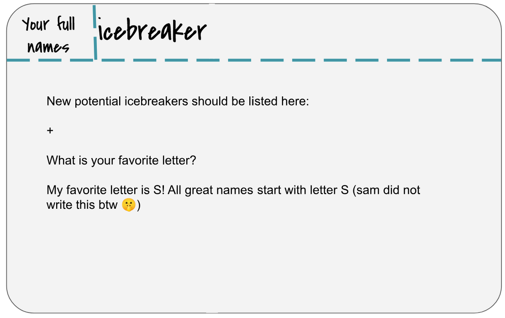
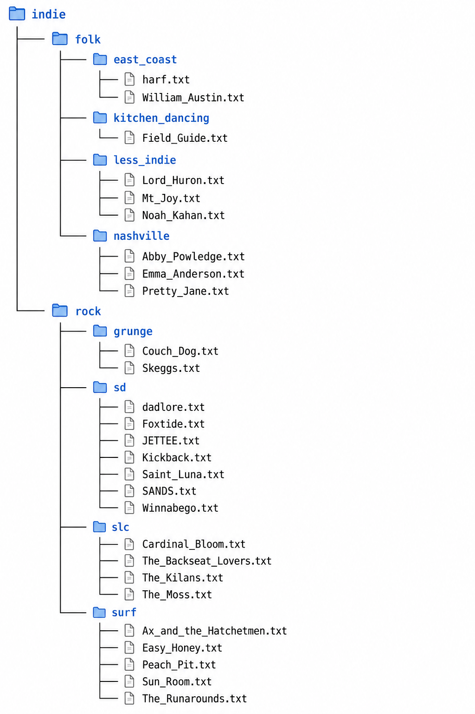
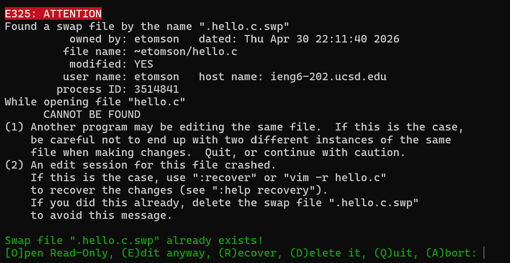
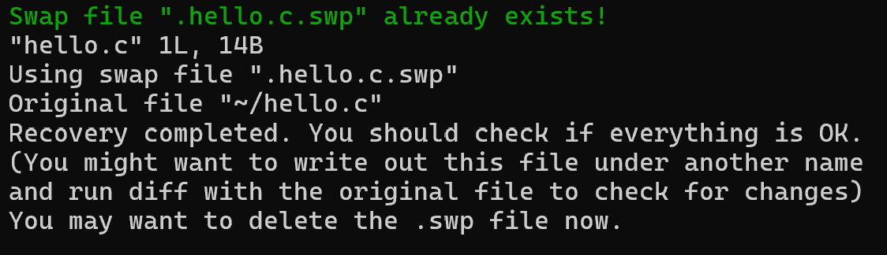
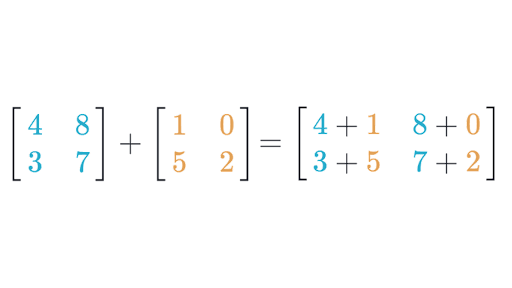
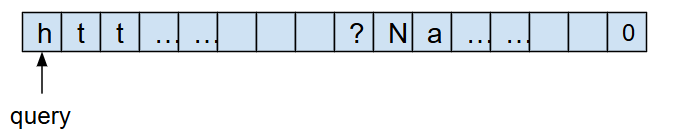
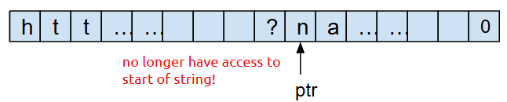

# Lab 5: Finding memory errors with Valgrind

<div class="note">

You may find our solutions to the previous labs in our [solutions repository](https://github.com/ucsd-cse29-fall2026/lab_solutions). For now, let's focus on lab 5.

</div>

In this lab, you'll use Valgrind, a memory error checker, to identify memory management mishaps in programs involving arrays and pointers. Valgrind is ubiquitous in systems programming workflows, especially for programs written in C and C++. You'll find it valuable for future Projects, too\!

## Lab 5 learning objectives

* Recognize the purpose of Valgrind in C programming
* Interpret output from Valgrind for memory-related problems
* Recognize Valgrind outputs for direct leaks, indirect leaks, use after free, and double free
* Use Valgrind to guide memory error fixing
* Recognize the value of automated tests in software development
* Write automated tests using assert statements


# Icebreaker

This week you have the opportunity to write an icebreaker that may be used in
future labs\! Please write an icebreaker of your own for this lab. One icebreaker
from last quarter was: _What is your favorite letter?_ which I encourage you to also answer.

  

<div class="exercise">

Please make sure that everyone in your group answers the icebreaker and writes their name on the whiteboard. We will come around to collect pictures for attendance soon\!

</div>

# Warmup: UNIX Golf




<div class="checkoff">

Consider “surf” as our starting directory and start there (current pwd). Complete each task in as few keystrokes as possible. Write your answers on your whiteboard then show a staff member.

1. Travis listened to Noah Kahan before he was big (totally). Move Noah Kahan to the east_coast directory, and rename him to Noah_Kahan_2024.txt.
2. Travis forgot to add Hozier! Add Hozier.txt to less_indie.
3. Travis only likes like one or two song from Skeggs. Remove Skeggs.txt

</div>


## Swap files
If you have ever gone to open your file and encountered the following:  
  
you may have wondered what is going on. This is the menu that appears when you try to open a file but your computer sees that it has an associated swap file. If your terminal crashes for some reason while you are editing it, you computer saves your work in a swap file named as follows: if you had `hello.c` it will create `.hello.c.swp` as the swap file (as seen in the picture above). In this file are the changes that it saved for you as it crashed. Reading through the options we find you can:

* Press `E` to open the last save you made. If you are ok with discarding the changes you made after you last `:w` you can choose this option.
* Press `R` to recover what is saved in the `.swp` file. If you haven't saved recently or simply would like to recover the changes you had made, choose this. After you choose this, you can type `:w` as normal in vim to save these recovered changes to your file.  

If you choose the latter option, you will see this menu.  
  
As per it's suggestion, after you have saved the file and go back to the terminal, you can and should delete the swap file (`rm .hello.c.swp` for example).  
If you choose the former option, you should also make sure to delete the swap file, for fear of later recovering a now out-of-date file.

## Some More Vim!
Let's learn about just a few more Vim commands that might be helpful for the labs and programming assignments.

### Moving Up and Down
You may have noticed that moving up and down line by line in a Vim file can be relatively slow.  Scrolling up and down the file would be faster!

To scroll **d**own in the file, <u>hold</u> the `Ctrl` key and press `d`.

To scroll **u**p in the file, <u>hold</u> the `Ctrl` key and press `u`.

# Part 1: Help! My program leaks…

Please clone the [Classroom 50 Assignment](https://classroom50.org/ucsd-cse29-fall2026/cse29-fa26/assignments/lab-5/accept) for this lab's starter code onto `ieng6` in your `cse29` directory. It contains code for a few programs that leak memory, and in this lab, we'll use Valgrind to detect these leaks and help fix them. In this repository you will find a `Valgrind` directory, start here.

Let's start with `leak.c`:

```bash
$ gcc leak.c -g -Wall -o leak
```

Remember `-g` from last week? This flag instructs GCC to add debugging symbols to the compiled executable. These symbols enable GDB to look up and show your source code during debugging. They also enable Valgrind to show you line numbers in its error backtraces.

Take a moment to review `leak.c` and predict what it should print, then run `./leak`. Although running the program gives no visible errors, the program actually produced some memory leaks as a result of us not properly freeing the allocated memory. The *Valgrind* program allows us to see how much memory is still being used when the program exits, and therefore leaked. Like with GDB, you pass in the program to inspect as an argument to valgrind. 

```bash
$ valgrind ./leak
```

We see a suggestion from valgrind to add `--leak-check=full` flag to instruct Valgrind to report the locations where leaked memory had been allocated:

```bash
$ valgrind --leak-check=full ./leak
```

Valgrind provides a “heap summary” of how much memory is still being used at exit, and a “leak summary” which details the different types of leaks that have occurred. When Valgrind reports anything in a leak summary, that means you have a memory leak! Memory leaks are especially harmful in long-running programs, where the amount of available memory gradually reduces over a long time, thereby also reducing the overall performance of the program or the computer in general.

Because we supplied the `--leak-check=full` flag, Valgrind also printed the stack trace at the instant where each chunk of leaked memory was allocated. **You might be inclined to think that the problem lies around the line number it references, but this is usually not the case!** Valgrind is just pointing out where the leaked memory got allocated. You, the programmer, decide where it is supposed to be freed. Sometimes, the appropriate place for a `free` call can be far away from its `malloc` call in your source code.

## Types of Memory Errors

Unlike real life (plumbing) leaks, it's okay to leave the (memory) leak in `leak.c` alone for now; we'll come back to it later.

In `memory_errors.c`, we demonstrate some common situations in which memory errors can occur. Rather than manually writing the compilation command, we've provided a Makefile for you to use. This will be helpful since we have quite a few files to compile in this lab. To compile a program, use the `make` command followed by the name of the file to compile without the `.c` suffix. For example, to compile `memory_errors.c` into the `memory_errors` binary file, use this command:
```bash
$ make memory_errors
```

In order to see more details of the leaked memory, make sure to add the `--leak-check=full` flag.

```bash
$ valgrind --leak-check=full ./memory_errors
```
With this flag, the Valgrind heap summary will also report the locations where leaked memory had been allocated, since we compiled the program with the `-g` flag.

Let's go over each function in `memory_errors.c` in more detail, and fix each of them:
- `memory_leak()`: In general, memory leaks occur when we allocate memory and do not free the memory before the program exits. Here, we fix the memory leak by calling `free()` on the pointer returned by `malloc()` which points to the allocated memory.
- `free_after_set()`: In this case, we lose the pointer to the allocated memory when we set it to `NULL`, therefore calling `free(p)` does not do anything. In general, we consider it good practice to set a freed pointer to `NULL`, but it actually needs to be freed first! We can fix this by making sure to call `free()` on the pointer before setting the pointer to `NULL`, instead of after.
- `double_free()`: This one isn't actually a memory leak, but it's an error that can occur with improper usage of `free()`, which is why it's here. Calling `free()` on a pointer that has already been freed is considered undefined behavior, meaning that it should not be expected to work properly. This program gives you a really messy memory error when you try to run it. Valgrind will also report an "invalid free" error above the heap summary. In this case, it's apparent why the double free error occurs and how to fix it, but in other cases it may be more obscure.
- `reuse_freed()`: Also not a memory leak, but a case in which we try to access memory that was already freed. Valgrind reports this error as an "invalid write" above the heap summary. Again, it's good practice to set a freed pointer to `NULL` immediately after it's been freed.
- `double_malloc()`: This can accidentally occur when you intend to allocate two blocks of memory to be used one after the other with the same pointer, but forget to free the first block. What should be done here to fix this leak?

<div class="owntime">

Once you've implemented the fixes, compile and re-run the program with Valgrind to confirm that there are no longer any memory leaks or errors. It should report that "all heap blocks were freed -- no leaks are possible". Yippee! Although if there are still memory leaks/errors, try again, then yippee.

</div>

## Types of Memory Leaks

You might have noticed in the leak summary of Valgrind that there are different types of memory leaks. The distinction between these leaks isn't too important for our purposes, but may help you identify how leaks are happening in a more complex program.

In `leak_types.c`, we demonstrate each of the different types in separate functions. There's no need to fix these leaks; just compile and run Valgrind on the program to see how Valgrind reports different types.
```bash
$ make leak_types
$ valgrind --leak-check=full ./leak_types
```
Notice how the heap summary gives you information on where each memory error occurs. Inspect the source code to see how each type is caused.

- Definitely lost: Besides myself, memory leaks are also considered "definitely lost" when the pointer to the memory becomes inaccessible. This can happen when the pointer is deleted when a function ends and its stack frame is deleted, or when the pointer is set to another value.
- Indirectly lost: Blocks of memory are considered "indirectly lost" when there exists a pointer in another leaked memory to the block. In this case, the memory pointed to by `pp` (i.e. `*pp`) is definitely lost, and the memory pointed to by `*pp` (i.e. `**pp`) is indirectly lost.
- Possibly lost: "Possibly lost" memory leaks occur when we have a pointer to some part of the leaked memory, but not to the base of the memory block, likely because the pointer was modified. In this case, we allocate an array of integers, then move the pointer to point to the middle of the array.
- Still reachable: Memory leaks are "still reachable" when the pointer is not lost when program exits, but the memory is still unfreed. This can occur when a global variable contains a pointer to leaked memory.
- Suppressed: Users can specify the flag `--suppressions=<filename>` to Valgrind to intentionally ignore leaks that are known to be harmless or unavoidable. If you want to learn how to use this flag, you can check out this [StackOverflow post](https://stackoverflow.com/questions/13692890/suppress-potential-memory-leak-in-valgrind), although in our (at least one old tutor and at least one old TA) experience this flag is seldom used, if at all.

## Valgrind on Arrays

Now let’s put what you’ve learned into practice. In the lab repository, `leak.c` and `losing_track.c` have memory leaks. You will identify and fix the problems in each program. Work with those around you\!

In `leak.c`, there is a function that performs matrix addition on two 2D arrays. While the functionality may appear correct, a run of valgrind will tell you that memory isn’t freed properly. For reference, here is a diagram of how matrix addition works:



<div class="important">

Please check in with your teammates to make sure everyone understands `leak.c` and it's problem and solution. If you have any questions now is a good time to ask a staff member as a group for any clarifications.

</div>

In `losing_track.c`, there is a function that returns the lower-cased version of the [query string](https://en.wikipedia.org/wiki/Query_string) of a url **without modifying the original string**. This is the portion after the question mark in http urls that are often used to specify parameters for a website. We want to return this portion without modifying the original URL. Like previously mentioned, this function appears to work properly, but does not manage memory properly. This error is particularly nasty because this implementation **loses track** of its allocated memory. Let's take a deeper look into what this means. 

When we first initialize `query`, we point to the beginning of the string, and therefore have access to our whole chunk of memory. Our memory looks like this:




However, after we convert the string to lower case, use `ptr` to traverse through the string, and return `ptr`, we no longer have access to the beginning of the string, and therefore can't free the chunk of memory!



<div class="exercise">

Describe the problem and how you would fix it. Work with your teammates and write this on your whiteboard. 
Do leave yourself space to add 2 more similar descriptions and fixes.

</div>

<div class="owntime">

Given time, you may implement the solution and check your work however implementing your solution is **OPTIONAL**. If you would like to implement your your solution, note that given this is a very involved change, **please** modify the method as much as you like!

*HINT: the problem of the current implementation is that in the string we return, we don't keep track of the beginning of the string. How can you change this code so that the string we return has its pointer pointing to the beginning?*

</div>


## Valgrind on Structs

As we prepare for our later projects, let's see how Valgrind can help us discover more memory problems. **Compile `log.c` and run it with Valgrind using the same flags from above.** In this case, it should report that 372 bytes of memory have been leaked. Follow the stack trace shown by Valgrind to contextualize yourself with the "story" of the lifetime of this chunk of memory. When did it get allocated? When do you think it should've been freed? How can you fix it?

A common misconception is that we can free memory by redirecting pointers to that memory to NULL, the null pointer. You can draw a memory diagram to see that this won't actually free that memory. Edit `log.c` so that the `main` function calls `free_log` instead of setting `ourLog` to `NULL`. Did this fix the leak?

Once you recompile and re-run with Valgrind, you should see a different error: `Invalid read of size 8`. This time around, Valgrind has a richer story to tell about this chunk of memory. Read the series of backtraces from the bottom line upward to see the events that took place in chronological order along with where they were triggered. Use this story to help understand the nature of the memory problem and figure out how to fix it. You can also pull out GDB if you'd like.

<div class="exercise">

Once you fix this error, re-compile and re-run the `log` program with Valgrind, and make sure that Valgrind reports no errors and that "no leaks are possible". Add the problem and solution to the whiteboard.

</div>

This is an example of "**use after free**", accessing a chunk of memory after you have freed it. The program might still have worked prior to your most recent fix, but because it accessed and relied on data inside a chunk of memory after it was freed, the program was subject to *undefined behavior*—it could crash, corrupt other memory it owns, or do whatever it wants! Thankfully, Valgrind can detect most instances of undefined behavior and help you eliminate it.

"**Double free**" is a specific kind of "use after free" where a program tries to free a chunk of memory that has previously been freed. Let's see how Valgrind reports instances of "double free". Duplicate the call to `free_log` in `main`, and recompile and rerun it with Valgrind.

In addition to `Invalid read of size 8`, where `free_log` attempts to access the `title` and `content` member of a freed `struct day`, Valgrind also reports `Invalid free() / delete / delete[] / realloc()` arising from the first `free()` call inside `free_log`. Now you know!

## Valgrind and uninitialized values

Another source of undefined behavior is reading from uninitialized memory. Valgrind can detect this, too! **Compile `writesong.c` using the same flags as above, but now, run Valgrind with the following:**

```
$ valgrind --track-origins=yes ./writesong
```

The program should write a simple song to `mysong.txt` using file I/O operations you will also encounter in PA 2. However, Valgrind reports several instances of "Conditional jump or move depends on uninitialised value(s)" and "Use of uninitialised value", and because we included the `--track-origins=yes` flag, it shows us where each uninitialized value was declared. The reports seem to repeat, indicating that an uninitialized value was used in a loop. Read the contents of `writesong.c` to figure out the problematic variable and initialize it properly. Verify that Valgrind no longer reports these errors when you run the program.

<div class="exercise">

You should now be able to tell if you've fixed the memory problem on your own! Add the problem identified and how you fixed it to your whiteboard.

</div>

<div class="checkoff">

Make sure to call over a staff member to go over your plan for how to fix the memory leak in `losing_track.c`, `log.c`, and `writesong.c` that are on your whiteboard.

</div>

As we have seen, Valgrind is useful for discovering memory bugs in your program. This will be especially useful in projects where you will be graded on proper memory management as you query and sort various data. Alongside Valgrind, we cannot understate the usefulness of **drawing memory diagrams** in helping you reason about memory management and fix memory issues. They make memory management much more intuitive, so embrace them!


# Part 2: Exposing bugs via automated testing

In this section, you will put your GDB and Valgrind skills into practice by finding and fixing bugs in an scheduling program. You'll also learn to write unit tests using assert statements to expose bugs. We hope that our introduction to testing helps you with writing your own tests in your projects\!


## Unpaid SWE Internship Experience

Congratulations on landing your first internship! It's been a long road filled with leetcode sessions, piles of rejections, and empty containers of your caffienated drink of choice, but it must all be worth it for this experience. Your first assignment jsut came in from your boss:

> Hello, dear Intern, I am the lead for our organization’s new and improved Course Registration and Appointment Platform! It’s practically a perfect system (except for a couple teeny tiny bugs) and has all the bells and whistles ready to ship (like a working weekly calendar)! However, there are those little bugs that do need fixing, and sitting around all day really tires me out, so I’m tasking YOU with handling those bugs. This is your first assignment, so try not to dissapoint! <div align="right">
> Sincerely, <div>
> Ben Schwarmer
</div>

You will be testing some bad implementations of some functions and finding out what’s wrong with them. Some of these implementations have memory leaks, others may be logically incorrect, and some of them just straight-up crash on certain inputs. It’s up to you to use all the tools in your debugging arsenal and all the knowledge you’ve gained to pick out the exact problem(s). Head to the `Testing` directory which is adjacent to `Valgrind`. Check out the `schedule.c` file to take a look at the code you’ll be critiquing.


We will stick to the following step-by-step process to remove defects from this file:

1. Write tests that *expose* an existing bug by failing, which can take the form of:
   1. An "Assertion failed" message
   2. Memory errors when the test is executed with Valgrind
   3. A program that never terminates
2. Use Valgrind and GDB to inspect how the tests failed
3. Implement a fix such that the tests pass

## Bad Clear Schedule

Given some argument `arg`, it checks if `arg` is true. If true (nonzero), it returns normally, and the code after the call to `assert` proceeds. If false (zero), it crashes the program immediately with an error message that includes the line number of the failing call to `assert`. While we can use the `assert` function to verify assumptions about our program, it is also essential in automated tests. `assert` function calls in automated tests check for an expected outcome. For example, a test may conceptually sound like:

> If I create an empty list, and I then call `add_course` on this list with `(29, 4)`, then (I assert that) the list should now contain one course with `course_id` equal to `29` and `units` equal to `4`.

Let's start with `test_clear_schedule_1`. Around line 131 in `schedule.c`, we have written an example test for you. Compile `schedule.c` with the `-g` flag, and run it with Valgrind. Identify and make your fixes to make our test pass with no errors from Valgrind. Feel free to write more tests to check more cases.


<div class="owntime">

**Test-First Development**
<br>*Feel free to skip this note and come back to it later.*

Most programming courses in higher education adopt a "Test-Last" approach, where we first write the implementation and then write tests to verify its correctness. What if we flip this order? The Agile programming community has advocated for *Test-First Development* (TFD), where whenever we want to develop a new feature, we first write tests (that would obviously fail), and we then write the implementation with the goal of making the tests pass. While this sounds counter-intuitive, following it in a disciplined manner has several benefits for software engineering:

1. TFD promotes high *test coverage*, meaning tests exercise many (if not all) parts of your implementation code
2. TFD encourages you to *refactor* your code, i.e., restructure it for performance, maintainability, etc. without worrying that you might break something because you can easily find out by running your tests
3. Some argue that TFD makes programming more fun and rewarding. Writing a test is like giving yourself a challenge, and seeing it pass for the first time is gratifying. On the other hand, writing tests last can seem like a chore.

However, TFD is criticized for its counter-intuitiveness, repeated context switching between testing and implementing, and being unsuitable for input/output applications. While we are not in a position to officially recommend Test-First Development, we want you to try it with your next PA and see if you like it.

</div>

Now that we have seen how an assert works for writing a few test cases and catching bugs, we shall write our own. We have given you 2 broken functions, `bad_drop_course` and `bad_copy_schedule`.

## Bad Drop Course

There are 2 problems with `bad_drop_course` in `schedule.c`. One will be caught by Valgrind, and the other we will have to find using asserts. Write assert statements to test this function, including one which should fail. Some test cases we usually want to consider when dealing with lists are what happens at the beginning, the end, and somewhere in between. Here's an example test you could write:

1. Create a schedule and add courses 12, 21, and 29 (with 4 units each).
2. Use `bad_drop_course` to drop the first course, 12
3. Assert that the first item of the list is now 21
4. Assert that the second item of the list is now 29
5. Assert that the third item of the list is NULL


Now that we have successfully found in which case the program does not give us the desired behavior, it is easier to pinpoint where in the code there is a problem.


## Bad Copy Schedule

At this point, you are probably getting bored of the uninspired section names. What we hope you haven’t gotten bored of is writing tests, because that is what you will be doing yet again.

The `bad_copy_schedule` function should take in a schedule and return a pointer to a deep copy of it. This means that if we were to add or drop a course from either the schedule or the copy, it should not affect the other. For example, if we are given the schedule [12, 21, 29], and we copy it, the copy should look like [12, 21, 29]. If we drop a course (say 21) from the original schedule, it should look like [12, 29, NULL] while the copy stays the same. For another example, say you have that same schedule and copy it again. Then if we use `clear_schedule` on the copy, it should be empty while the original schedule is unchanged.


Use these examples to help you write tests that expose the bugs in `bad_copy_schedule`.


After finding the bug, now you should be able to debug the code and implement a working solution.

<div class="gradescope">

**You must also fill out this [mid-quarter survey](https://forms.gle/k3MH73hDgMXvuycT6).**

Submit your repository to gradescope!  
Notes on the autograder:  
- Tests must go in the four test functions; anything written in main is ignored.
- Students have to add the missing frees to the example test, because the leak check covers it too.
- The structs and function names must not change. (edited)

**You must also fill out this [mid-quarter survey](https://forms.gle/k3MH73hDgMXvuycT6).**


</div>

# Next steps

If you finish with the lab content above you may any do the following:
* Go back to the "On your own time!" sections and do them.
* Continue reading and work on the buffer overflow task that was also available last week. Surprise! it was a lab5 preview all along.
* Work on PA2


