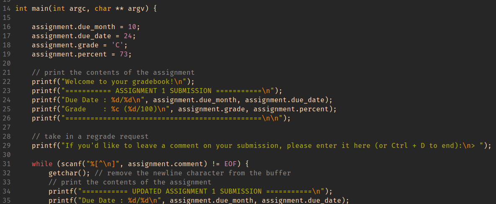

# Lab 7: Shell scripting, Buffer Overflow, and Workspace Configuration 
In this lab, you will hack a gradebook to give yourself an A on an assignment, and organize some nostalgic files using shell scripting.

## Lab 7 learning objectives

* Understand how buffer overflow works and why it is bad
* Understand the utility and overall mechanism of shell scripting


Can you guess what part of campus each of these photos was taken? Work with your groupmates\! Google Maps is allowed\!


<figure>
    
    
    
    
</figure>

<div class="important">

Please write the answers on your whiteboard!

</div>


## Configuration files to improve quality of life

### SSH Config
In this class, we mostly use the `ieng6` server. However, in the future you might have access to multiple servers for which you want to create separate SSH keys. To help us keep track of our SSH keys, we can create a configuration file called an SSH config file.

Exit the `ieng6` server one more time, and create this SSH config file inside your `.ssh` directory that is in your home directory on your computer.
```
$ vim ~/.ssh/config
```

<div class="note">

If on windows you can do `notepad ~/.ssh/config`  
It may create the file as `config.txt` and you will need to rename it to `config`

</div>

Copy the following lines and paste them into the `config` you just created and opened.
```
Host ieng6
    HostName ieng6.ucsd.edu
    User <username>
    IdentityFile ~/.ssh/id_rsa
```

<div class="note">

The default place for the private key is `~/.ssh/id_rsa` so this particular `IdentityFile` line is unnecessary. If when you use `ssh-keygen` you *do* specify a filename for your keys, this is how you would use it for a particular host. (you could have named it `key-to-ieng6` and then you would simply put the path to that new private key in the config)

</div>


Replace `<username>` with your `ieng6` username.  The `IdentityFile` field specifies the filename for the private key created to access the given server.

Now try to login to your `ieng6` account again. This time, you can type the `ssh` command in a shorthand form using the name provided in the `ssh` config file after `Host`, which is `ieng6` in this case.
```
$ ssh ieng6
```
This configuration file can contain many entries to manage access to multiple sets of `ssh` keys for various servers that you might have access to in the future. And it will save you some typing also. How nice!


### Custom Configuration
So far, we have seen that Vim commands can be manually typed in an open Vim window, however this can quickly become repetitive if you commonly want to execute the same commands every time you open a new Vim window.

Alternatively, we can tell Vim to execute a certain set of commands automatically every time we open a Vim window in the future. For example, we can type a command to enable syntax highlighting in Vim, which will add syntax-specific coloring to your code and will vastly improve your experience reading through code in Vim.  Another Vim nicety we might want to enable is adding line numbers to the file. There are many, many different commands and settings that we can enable and configure to create our own personal Vim experience, which will make writing code in Vim much more enjoyable!

We can do this by putting these commands directly into a Vim runtime configuration file, called a `.vimrc` file.

<div class="note">

The `.` prefix means that it is a hidden file in UNIX, also commonly called a *dotfile*.  This means that these files will not display, by default, when listing the contents of a directory (using the `ls` command).

</div>

By convention, you will create the `.vimrc` file in your home directory:  `~/.vimrc`

<div class="note">

Remember: the tilde character `~` is a shorthand for the current user's (your) home directory in UNIX.

</div>

#### Editing your .vimrc

We provided you with a `.vimrc` file in [lab 1](../week1/index.html#the-vim-text-editor)
Using Vim, open the `.vimrc` file in your home directory on your `ieng6` account:
```
$ vim ~/.vimrc
```

You will see the following lines into your empty `.vimrc` file, as shown in the code snippet below:
```
syntax on
set number
set belloff=all
set showtabline=2   " always show buffer tabs
set tabstop=4
set noexpandtab   "ensures tabs do not expand to spaces
set autoindent
set cindent
inoremap { {<CR>}<Esc>ko
set shiftwidth=4
set backspace=indent,eol,start
```

The effect of each of these commands is summarized briefly below:
- `syntax on`: enable syntax highlighting
- `set number`: display line numbers in Vim
- `set belloff=all`: disable Vim bell sounds
- `set showtabline=2`: always show buffer tabs
- `set tabstop=4`: set tabs to be four spaces
- `set noexpandtab`: does not expand tabs to space
- `set autoindent`: apply indentation to next line based on current line
- `set cindent`: apply indentation with respect to C code syntax
- `inoremap { {<CR>}<Esc>ko`: autocompletion of curly braces for ease of use
- `set shiftwidth=4` : Ensures the size of indentation when using `<<` or `>>` in normal mode is 4 spaces
- `set backspace=indent,eol,start` : Allows you to backspace over automatically placed indentations, line breaks, and text entered before entering insert mode

<div class="note">

If you find yourself ever working with python, you may want to switch `set noexpandtab` to `set expandtab`. Python cannot handle having mixed tabs and spaces and will error with the message [`TabError: inconsistent use of tabs and spaces in indentation`](./assets/l5_python.png).
If you have `set noexpandtab` set and edit a python file that uses spaces, this will occur. For our future purposes we need to have real tab characters for when we learn about Makefiles!

</div>

<div class="warning">

In general, you should not paste a command into your `.vimrc` if you are not sure what it is doing. But you can *definitely* trust us! :D

</div>

These are our suggestions for `.vimrc` settings that we think are helpful for you in this class. If you feel like you don't like some of these features, feel free to remove the corresponding lines in the `.vimrc` file. These configuration files are usually customized to each programmer's preferences&mdash;figure out what works well for you!

One customization that we have not added that we highly encourage you to check out is `:color <color>` you can open a file and type `:color ` and press tab to toggle through the available options OR you can see the list of available colors on `ieng6` in the `/usr/share/vim/vim91/colors` directory. 


<h1 id="hacking" style="color: #00ff41 !important; background-color: #0d0d0d; font-family: 'Courier New', Courier, monospace; padding: 10px 20px;text-shadow: 0 0 8px #00ff41, 0 0 20px #00ff41; border-radius: 4px; letter-spacing: 4px;">HACKING</h1>

Start by cloning our [classroom 50 assignment](https://classroom50.org/ucsd-cse29-fall2026/cse29-fa26/assignments/lab-7/accept)
into your ieng6 account, as usual.

## Background

Imagine that you're a less ethical student than I'm sure you actually are. You
overhear from some other students in lab that there's a binary available on the
pi-cluster that can show you your grades on assignments before we formally
release them. You hear quieter whispers that someone found a way to use it to
_change_ their grade. Given our less-than-ethical assumption about your state
of mind, you might be tempted to exploit this for yourself.  

## The Plot Thickens

You see some code open on the professor's laptop during office hours.  You do
your best to commit it to memory and write it down (remember, you're acting
quite unethically in this story), because it strikes you that the code was
something regarding assignment scores.  


<div class="exercise">

Using this information, you decide to give yourself and A with a score 
to match while maintaining a real due date.  
**HINT**
When important values are adjacent on the stack, overflowing an array with
values that you control can let you assign into other stack-allocated values.  
Given the variable names as seen in the source code shown above, you can use the GDB commands below to give you information about how the memory is laid out.  

A recommended place to start is by typing a very long comment and then using GDB to print values around the variables in the struct called `assignment` to see where the values ended up.  
Remember to work together and that the staff is there to answer any questions your group has.
</div>


-   `(gdb) info locals`

-   `(gdb) info args`

-   `(gdb) print VALUE (or p VALUE)` You can print any variable or expression, e.g.

-   `print x`, `p arr[5]`, `p ((x & 0b1111) << 3)`

-   You can also specify a format to print in

-   `print/t` (binary), `print/x` (hex), `print/d` (decimal)

-   `(gdb) x ADDRESS` This prints out memory at an address, e.g. strings / arrays / pointers

-   `(gdb) x/16cb str1` This prints the first 16 bytes of `str1` as characters

-   `(gdb) x/20xb str2` This prints 20 bytes of `str2` in hex

-   `(gdb) x/4dw  arr` This prints 4 "words" (i.e. `int32s`) of `arr`, as decimal numbers

-   You can use the following [reference card](https://darkdust.net/files/GDB%20Cheat%20Sheet.pdf) for reference on gdb commands, and format commands for x and print.

<div class="checkoff">

Write your method for solving this problem on your whiteboard. Get checked off by a staff member.

Also make sure to add your comment to `gradebook/comment.txt` to be graded on gradescope
</div>


# What the Shell?

> The other day, I was working on a class assignment that had me running a bunch
> of stress test diagnostics for a cloud system. Each test took about a minute
> to run, and I had to run a bunch of these.
>
> One of my partners asked “why not write a shell script?” And so I did. What
> would have been twenty-five times of typing the same command with different
> numbers turned into a single script I could run once and then go about my day.
> Now, that script probably took more than 25 minutes to write, but that's
> beside the point.

Today, you will use shell scripting to organize a messy file system.

 Next, **change into the `minihome` directory**
and take a look at its contents. This directory structure should hopefully look
familiar to you!

Before we get started though, let’s talk about shell scripting and the
executable bit.

A **shell script**, as its name suggests, is a script that runs a series of
shell commands that accomplishes some tasks. These scripts can get very
complicated depending on the task being automated, but even simple shell
scripts can save lots of time. In the coming weeks, you may want to *write a shell script that runs all the tests in PA 3*, for example.


## Task 0: Run a script

<div style="padding: 0 8px; border: 2px solid #cc0004; color: #cc0004">

💡 **KEY POINT**: Any command that you can run on the command line can be
an instruction in a shell script.

</div>

* Fill the provided `task_1.sh` file with some commands that you know like `echo`, `ls`, or `pwd`. Each command should be on a new line.
* To mark the file as executable, run `chmod +x task_1.sh`.
* Try running `./task_1.sh` in your command line, and you should see the output of each command in the order you added them to the shell script.

<div class="note">

The `#!/bin/bash` at the top specifies that this script should be parsed using
the bash program at the directory `/bin/`. The leading `#!` is called a
"shebang" and signals the start of this directive. A Python script, for example,
could have `#!/usr/bin/python3` as its first line instead.

</div>

Here’s an example you can try. Put the following content in `task_1.sh`:

```bash
#!/bin/bash

echo "Hello!"
echo "Goodbye!"
```

And then, run it. If you see _Permission denied_ and don't know what to do, go
read the [executable bit](./lab2#aside-the-executable-bit) section from lab 2.

```
$ ./task_1.sh
Hello!
Goodbye!
```

As it turns out, all that is needed to complete the above task is to run a
couple of commands sequentially. Here are a couple of knowledge bits that could
be helpful:

<div class="note">

**The wildcard pattern `*`**

In shell scripting, the `*` character acts as a way to target all files and directories. For example, if you ran `cat *`, you would print out the contents of all the files in your current working directory (you would likely also get error messages from trying to view the contents of folders in your directory).  Furthermore, the `*` character can also be used to match specific patterns. For example, if you ran `cat *.txt`, you would print out the contents of all the files in your working directory that have the `.txt` extension.

</div>

<div class="note">

**The `mv` command**

The move command, as its name suggests, can be used to move files into directories. For example, you can use it like so:

```bash
mv a.txt Books
```

This will move a.txt into the Books directory. You can also move multiple files at once like so: `mv a.txt b.txt Books`, which will move a.txt and b.txt into the Books directory.

</div>

## Task 1: Books and Music

With these tidbits, you are now ready to write your (possibly) first ever shell script\! **Your first task will be to write a shell script to organize the text and mp3 files in `minihome` into the `Books` and `Music` directories.** Please work on this with your groupmates if you so wish. As a reminder, you can use the `ls -R` command you all discovered back in lab 1 to test if your files ended up in the right place. While testing your script, you may end up accidentally messing up your directory structure. If this happens, we have provided you with a `reset_task_1.sh` script in the **minihome** directory which you can run to reset the .txt and .mp3 files. This will leave your .sh files intact, however, so don’t worry about losing your progress.


Our minihome is now looking a lot cleaner. But maybe we can go further. The length of these books seems a bit varied, no? It would be nice if we were able to sort these books into **short stories** and **novels**. This will be your next task. One requirement for your script is that you should be able to supply an **argument** for the cutoff between a novel and a short story. Before you begin the task, **first change into the `Books` directory**.

Here are some knowledge bits that could be useful:

## Shell scripting - variables

You can declare and use variables like so in shell scripting:

```bash
# Contents of demo.sh
#!/bin/bash
num=5
fruit="apples"
echo $num $fruit
```

```
$ ./demo.sh
5 apples
```

To reference a variable, you simply put a dollar sign in front of it.
Note that this still works inside double-quoted strings, so `echo "$num $fruit"` would have achieved the same effect in the script above. To print out `$num $fruit` literally, you would need to either use single quotes (`'$num $fruit'`) or escape the dollar signs (`"\$num \$fruit"`).

## Shell scripting \- accessing command line arguments

To access the `n`th command line argument, use `$n` in your script. For example, the 1st command line argument would be accessed with `$1`. Note that the 0th command line argument is the name of the command you executed. Here is a demonstration:

```bash
# Contents of demo.sh
#!/bin/bash
echo $1 $2
```

```
$ ./demo.sh 5 apples and more
5 apples
```

Note that a string wrapped in quotes counts as one argument. For example, in: `$ ./demo.sh 2 "PA 2"`  We have `$1` equal to `2` and `$2` equal to `PA 2`.

## Shell scripting \- if statements

The basic structure of an if statement in shell scripting is as follows:

```bash
if [ condition ]; then
    # Commands if condition is true
else
    # Commands if condition is false
fi
```

Here is an example of a script that takes in a number from the user, and prints out whether or not it is greater than 5:

```bash
# Contents of demo.sh
if [ $1 -gt 5 ]; then
    echo "Number is greater than 5"
else
    echo "Number is 5 or less"
fi
```

```
$ ./demo.sh 10
Number is greater than 5
```

As you can see, most operators (save for string equality) in bash scripts are different from what you would see in most other programming languages; they look like a hyphen followed by an mnemonic string. Here, the `-gt` comparison operator checks if `$1` is greater than 5\. Though you likely won’t need them for this task, here is a decently comprehensive list of the different types of conditional operators you can find in shell scripting:

**File/directory existence:**

```bash
if [ -f filename ]; then   # Check if file exists
if [ -d directory ]; then  # Check if directory exists
if [ -e filename ]; then   # Check if file or directory exists
if [ -s filename ]; then   # Check if file exists and is not empty
if [ -x filename ]; then   # Check if file is executable
```

**String comparison:**

```bash
if [ "$str1" = "$str2" ]; then   # Strings are equal
if [ "$str1" != "$str2" ]; then  # Strings are not equal
if [ -z "$str1" ]; then          # String is empty
if [ -n "$str1" ]; then          # String is not empty
```

**Numerical comparison:**

```bash
if [ "$num1" -eq "$num2" ]; then   # Numbers are equal
if [ "$num1" -ne "$num2" ]; then   # Numbers are not equal
if [ "$num1" -gt "$num2" ]; then   # num1 is greater than num2
if [ "$num1" -lt "$num2" ]; then   # num1 is less than num2
if [ "$num1" -ge "$num2" ]; then   # num1 is greater than or equal to num2
if [ "$num1" -le "$num2" ]; then   # num1 is less than or equal to num2
```

## Shell scripting \- for loops

In Bash, there are many different types of loops, each having their use cases. Here, we’ll introduce one of those loops: the for loop. The basic syntax is as follows:

```bash
for item in [list of items]; do
  # do something with $item
done
```

Here are some examples of how you can use a for loop:

* Looping through variables:

  ```bash
  for var in item1 item2 item3; do
    echo "$var"
  done
  ```

* Looping through a range of numbers:

  ```bash
  for i in {1..5}; do
    echo "Number: $i"
  done
  ```

* Looping through files in a directory:

  ```bash
  for file in *.txt; do
    echo "Processing $file"
  done
  ```

## The `wc` command

Here, `wc` does not stand for water closet, but rather word count. Passing it a text file will print out the number of lines, words, and characters in that file followed by the name of that file. For example:
```
$ wc alice.txt
3757  29564 174357 alice.txt
```
To print out just the number of lines, words, and characters, You can use the `-l`, `-w`, and `-c` options respectively:

```
$ wc -l alice.txt
3757 alice.txt
$ wc -w alice.txt
29564 alice.txt
$ wc -c alice.txt
174357 alice.txt
```

If you don’t want the name of the file after, and only wanted the number for whatever reason, you can redirect the contents of the file in to the `wc` command like so:

```
$ wc < alice.txt
3757  29564 174357
$ wc -l < alice.txt
3757
```

Neat!

## Shell scripting - command substitution
You can run a command and assign its output (as a string) to a variable using `var=$(command)`. For example:

```bash
lines=$(wc -l < sample.txt)
echo $lines
```

This would store the number of lines in `sample.txt` into `lines` and print it.

## Task 2: Novels and Short Stories

With the above knowledge, you can now write a script to sort text files into the `Novels` and `Short_Stories` folder based on their word length **from scratch**. In `task_2.sh`, we have provided you a base script to work off of, with blanks for you to fill. There is also a `reset_task_2.sh` script, should you wish to restart. To test if your script works, 20000 works well as an argument for differentiating between Novels and Short Stories. Good luck, and have fun\!


Once you have **made sure** that both of your scripts work, we may now proceed to the fun part. First change back to the `minihome` directory, run the `reset_task_3.sh` script to undo the changes from both task 1 and task 2\. Next, run the `task_3.sh` script. This is a pre-written script that will run your tasks 1 and 2 in succession. This means that in **one command**, you can sort all of your files into `Books`, `Novels`, `Short_Stories`, and `Music` folders\!

Confirm that all the text files are in the `Novel` folder (we used a lower threshold), and all the mp3 files are in the `Music` folder, and run the `reset_task_3.sh` script. **Make sure your script works before running the next step\!**

Let’s pretend our user has done a lot of internet browsing and downloaded a lot of files. Run the `simulate_downloads.sh` script.

That’s a lot of txt and mp3 files\! Normally it would take quite a while to sort these out, but luckily, we have our script\! Run `task_3.sh`, and hopefully you should see all of the files get sorted. What normally would have taken perhaps an hour can now be done in an instant\!

<div class="gradescope">

Please submit your `gradebook/comment.txt`, `minihome/task_1.sh` and `minihome/Books/task_2.sh` to gradescope.
</div>


<div class="quality">

As you continue to use vim, you may want to consider tools to enhance your experience. Below are several options:

Vundle -- a plugin manager for vim <https://github.com/vundlevim/vundle.vim>

vimawesome -- a site with plugins you can add with the help of vundle <https://vimawesome.com/>

These would take longer to customize so feel free to take a few minutes to look through these but do continue on without much delay.

</div>