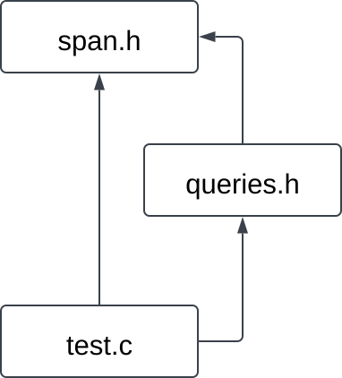

# Lab 8: Mail and Header Guards
In this lab, you will fix compiler errors by adding a header guard, and send mail messages with Pokemon. You have the entire lab period for this. Have fun!

## Lab 8 learning objectives

* Recognize the purpose of header files
* Understand the need for header guards
* Trade Pokemon by sending and receiving mail on `ieng6`!


# <a href="./assets/yougotmail.mp3" target="_blank">You've got Mail!</a>

The mail command, unlike other commands we’ve taught you in this lab and previous ones, is especially unique: literally no one\* uses this\! As such, this section is not relevant to any course material. But the idea of sending each other mail via the terminal, all 1970s-core, is too appealing to pass up on.

_\* By “literally no one”, I mean “literally no one, except for at least one person at this university”, so I’ve been told._

Throughout this section, we’ll use `myname` and `friendname` to refer to your and your partner’s UCSD username, respectively. This is the username you use for your UCSD email, and the one you use to log into ieng6.

In order for mail to work, you and whoever you are mailing to must be on the same cluster on ieng6. You do not need to know what a cluster is, but you do need to know how to SSH into a specific one on ieng6. If each line of your command prompt starts with this:

```
[myname@ieng6-640]:~:500$
```

Then `ieng6-640` is the cluster you are logged into. In order to SSH into a specific cluster, exit out of your current SSH session, and in your local machine terminal, type:

<code>
  $ ssh
  <span contenteditable class="code-replace-me">myname</span>@ieng6-640.ucsd.edu
</code>

And enter your password as usual. Make sure both you and your partner are on cluster 640\.

<div class="important">

In the following instructions, you will use the `mail` command, but it is not
available on the `ieng6-2xx` servers. Please make sure to **log out of `ieng6`**
and **then** sign into **`ieng6-640.ucsd.edu`**! This specific cluster runs an older
operating system that still has the `mail` command.

</div>

Once you and your partner are in the same cluster, try using the mail command to begin composing an e-mail (electronic mail). Either command below works:

```
$ mail friendname@ieng6-640.ucsd.edu
$ mail friendname@ieng6-640
```

This will prompt you with `Cc:` and you can type any additional emails you would like to send your mail to in a comma-seperated list. Then it will prompt you with `Subject:` so you can type your email’s subject. The subject is only one line of test, so when you press Enter you are now typing the contents of your mail. When done writing your message, press `Enter` to ensure you are on a new line, then press`Ctrl+D` to finish and send.

Now, your partner can use the `mail` command by itself to see that they have received mail\! It will have a number next to it as it enumerates messages every time you open the mail shell. Type this number and press `Enter` to see the message.

Now that you have mail and therefore can enter the mail shell, you can type `?` to get a list of commands that you can use.

```
type <message list>          type messages
next                         goto and type next message
from <message list>          give head lines of messages
headers                      print out active message headers
delete <message list>        delete messages
undelete <message list>      undelete messages
save <message list> folder   append messages to folder and mark as saved
copy <message list> folder   append messages to folder without marking them
write <message list> file    append message texts to file, save attachments
preserve <message list>      keep incoming messages in mailbox even if saved
Reply <message list>         reply to message senders
reply <message list>         reply to message senders and all recipients
mail addresses               mail to specific recipients
file folder                  change to another folder
quit                         quit and apply changes to folder
xit                          quit and discard changes made to folder
!                            shell escape
cd <directory>               chdir to directory or home if none given
list                         list names of all available commands

A <message list> consists of integers, ranges of same, or other criteria
separated by spaces.  If omitted, Mail uses the last message typed.
```

Note that when the help dialog says “folder”, this is a bit of a misnomer. The “folder” is actually the filename that the command will use. For the `save` and `copy` commands, you can give it a valid path to a file and it will save or copy the contents of the email into the file. The path is relative to wherever you opened the mail shell.

You will likely not need to use all of these commands but at least a few are worth noting:

* `type <message list>` can be used to print out the contents of selected messages. For example, `type 3 4` prints out the contents of messages 3 and 4\.
* `headers` will print out the list of enumerated messages along with their senders, subjects, and statuses.
* You can respond to a message with `Reply <message list>`, which will open a response to the message to type in a reply. Again, you can finish and send with `Ctrl+D`. For example, `Reply 5` opens a response to message 5\.

There also exists another method to send mail from outside the mail shell, using the pipe operator we learned earlier. This command also makes use of the `echo` command, which outputs its argument to stdout. Sounds redundant, but it’s intended to be used in this way to input strings into other commands, or to be used as print statements in bash scripts.

<code>
  $ echo
  <span contenteditable class="code-replace-me">"email body here"</span>
  | mail -s
  <span contenteditable class="code-replace-me">"subject here"</span>
  <span contenteditable class="code-replace-me">friendname</span>@ieng6-640.ucsd.edu
</code>

## Trading Pokemon

You will need to accept the following [classroom 50 assignment](https://classroom50.org/ucsd-cse29-fall2026/cse29-fa26/assignments/lab-8/accept) for the rest of this lab.

We can also use email to send attachments in the form of files. In this section, we’ll trade Pokemon with each other via mail. We will use the `pokeget.sh` script provided in your lab starter code for fun to generate some files with Pokemon in them. First, let one person be the sender, and the other will be the receiver. After you can successfully send and receive Pokemon from one to the other, swap roles and try sending one the other way.

### Sender

Use the below command to generate a ".pk" file with the name of the Pokemon you picked. For example, if you picked Pikachu, \#25, you would call this file `pikachu.pk`. Alternatively, if you want the receiver to not know what the Pokemon is until they open the file, you can call it `mystery.pk`. Feel free to replace `25` with the [National Dex number](https://www.pokemon.com/us/pokedex) of any Pokemon.

```
./pokeget.sh 25 > pikachu.pk
```

If the `pokeget.sh` script seems to take more than a few seconds to finish running, try using `Ctrl + C` to interrupt the program and try running the same command again.

Once you have a ".pk" file, use the following command to send it to your partner, using the `-A` option. Replace "pikachu.pk" with the name of your Pokemon file if it is different.

<code>
  $ echo
  <span contenteditable class="code-replace-me">"email body here"</span>
  |
  mail -s
  <span contenteditable class="code-replace-me">"subject here"</span>
  -A
  <span contenteditable class="code-replace-me">pikachu.pk</span>
  <span contenteditable class="code-replace-me">friendname</span>@ieng6-640.ucsd.edu
</code>

### Receiver

Open up your mail shell with the mail command. You should have a new email if the sender did their job properly. Type the following command to save the email you received as a file, with `n` replaced by the ID number of the email. Note that the “&” is the prompt, and does not need to be typed, just like “$” in the terminal.

```
& save n pokemon.mail
```

Extracting the attachment in a readable form from the email itself is quite involved, so please use the provided script to get your Pokemon:

```
./extract_pokemon.sh pokemon.mail > pokemon.pk
cat pokemon.pk
```

<div class="note">

If you get an error running `extract_pokemon.sh` that mentions something about a bad interpreter, this is likely because the file hasn't been formatted for unix correctly yet. Run `sed -i 's/\r$//' extract_pokemon.sh` to reformat the file and try again.

</div>


If everything went well, you should get the Pokemon your partner sent you\! Have a bit of fun with this and send each other some cool Pokemon.

<div class="checkoff">

Please spend a couple minutes drawing the pokemon you received from your neighbor.
You can take turns drawing and reading through the next part.

</div>

## Header Guards

```c
#ifndef EXAMPLE_H
#define EXAMPLE_H

struct example {
    char *str;
};

void foo(int bar, char * s);

#endif
```

Header guards prevent the content within them from being processed multiple times by the compiler.
This can be problematic if the header file intends to *define* any symbol, not just *declare* them.
In the example above, the header guard ensures that `struct example` is defined at most once.
Let's illustrate the utility of header guards with a concrete example.

After cloning the classroom 50 repository onto `ieng6`, `cd` into `headers` and inspect the contents of the five `.c` and `.h` files inside. These files together represent 3 "modules" with the following dependency graph:



When the compiler reads `test.c`, its preprocessor will process `span.h` twice: once through the direct arrow pointing to `span.h` and once through `queries.h`, which also points to `span.h`. As a result, the contents of `span.h` will be "pasted" into the source file twice. Since `span.h` contains a struct *definition* for `struct string_span`, this definition will be repeated twice. Try the following compilation command to see what this causes:

```
$ gcc span.c queries.c test.c -Wall -o test
```

The compiler seems to be confused by the duplicated definition for `struct string_span`, which is the first error it reports. 

<div class="gradescope">

Use what you have learned about header guards to fix this compiler error! Please note that by convention, everything in a header file is wrapped in a header guard. Push this and your pokemon to Github and submit to gradescope!

</div>


## The Finale

There are now 2 fun optional activities you can complete:

* Mass mailing, where you send your pokemon to a mailing list of recipients who would be delighted to have your pokemon
* Pokemon `.bash_profile`, how to add pokemon to print whenever you open your terminal.

You can do either or neither in any order, they are here for your own practice and amusement.

## Mass mailing <span class="label label-purple">Optional</span>

Another useful function in scripting is the while loop. For example, running:

```bash
while read character; do
    echo "$character is a transformer"
done <transformers.txt
```

Given that `transformers.txt` contains:

```
Optimus Prime
Bumblebee
Grimlock
Kickback
Hardshell
Starscream
Megatron
Metroplex
Ironhide
```

Will print:

```
Optimus Prime is a transformer
Bumblebee is a transformer
Grimlock is a transformer
Kickback is a transformer
Hardshell is a transformer
Starscream is a transformer
Megatron is a transformer
Metroplex is a transformer
Ironhide is a transformer
```

Given this and the command to send mail:

<code>
  $ echo
  <span contenteditable class="code-replace-me">"email body here"</span>
  |
  mail -s
  <span contenteditable class="code-replace-me">"subject here"</span>
  -A
  <span contenteditable class="code-replace-me">filename</span>
  <span contenteditable class="code-replace-me">friendname</span>@ieng6-640.ucsd.edu
</code>

Where `-A filename` will attach the file with `filename` to the email, **send everyone in `recipients.txt` your Pokemon**. Please send this to the list in `recipients.txt` **no more than once**. To test your loop, you may want to make a file of your groupmates' emails in the same format of `recipients.txt`. Note that you may also send mail to yourself.

## Adding Pokemon to `.bash_profile` <span class="label label-purple">Optional</span>

If you would like your Pokemon to appear when you open ieng6, you may do the following.

If you would like 1 Pokemon, add the line <code>cat <span contenteditable class="code-replace-me">~/path/to/pokemon.pk</span></code> (replace the path with the entire path to your Pokemon file, starting with `~`) to the end of the `.bash_profile` file in your home directory.

If you would like 2 Pokemon, add the line <code>paste <span contenteditable class="code-replace-me">~/path/to/pokemon/bigPoke.pk</span> <span contenteditable class="code-replace-me">~/path/to/pokemon/smallPoke.pk</span></code> (replace the path with the actual path to your Pokemon file) to the end of the `.bash_profile` file in your home directory. Note that if you paste the smaller Pokemon first, the larger one will be cut in half. You are welcome to try to troubleshoot this.

If you want to do the same thing on your own computer, you can add this same line to your `.bash_profile` or `.bashrc` file. Just make sure to download the referenced `.pk` files using `pokeget.sh` and edit the paths as needed!

## Other Real world Script examples:

A [real life script](https://github.com/kizhikevich/violating_ripe_probes/blob/main/atlas_pipeline/run_atlas_pipeline.sh) by [Katherine Izhikevich](https://kizhikevich.github.io/) and [Ben Du](https://www.bencdu.com/)    which run several python scripts to retrieve and sort through data.

The script Elena made to print out pokemon randomly when she opens ieng6 [pokemon.sh](.assets//pokemon.sh) (complete with commented out old path variables before she figured out how to pick randomly from an arbitrary amount of directories.)

The script Elena made to print out Joe quotes also upon opening ieng6. [juotes.sh](./assets/juotes.sh) Note that the file is full of lines that look like 
```
Feb 10 -|Energy is priceless, but so is uninterrupted descriptions of structs.
Sept25 2025 @10:16? -|I'm thankful to the computer engineering wizards that provided the magic sand to do this
```

The script Brendan made to automatically zip and re-install python addons for the 3D software Blender. [blender_addon_updater.sh](./assets/blender_addon_updater.sh)

> Note: Understanding scripts.  
> Bash scripting is no small undertaking to understand. It's basically a whole new programming language with it's own syntax and rules, and while this lab covers a ton of the basics, there is a whole truckload of other things. While you do not know everything there is to know about bash-scripting, you do have a foundation of knowledge and *internet access*. Both google searching and asking ChatGPT *can* be super helpful for 2 things: understanding a script, and making one.  
> Wonder what mapfile is? googling this gets an AI overview describing it *and* a link to a man page. This may lead you to the thought "oh right the man pages, maybe I should check it on my computer".  
> pokemon.sh was made with much help from ChatGPT. Elena had a starting point but was unfamiliar with how to get prefixes, suffixes, or how exactly to randomly pick between folders. So, she used ChatGPT how she might switch the file extension from .mail to .pk. Prompts included "how would I remove a prefix" and "how do i pick randomly from a list" to piece together the script.  
> It is also noteworthy that GenAI models will be good at things they have a lot of training on. Common things like what we find in pokemon.sh they will get correct a lot. **Things they are not as well trained on they may very well get wrong and they will do it confidently**. So, please do be careful.

